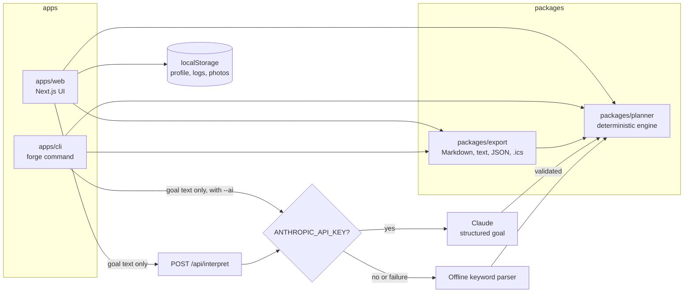

# Forge

**A workout plan built around your body, your goals and the gear you actually own.**

[](https://github.com/Zoriyonz/forge-ai-workout-planner/actions/workflows/ci.yml)
[](LICENSE)


Enter your measurements, describe your goal in plain English, and pick the equipment you have. Forge builds a weekly plan that only uses what you own, then helps you track progress privately in your browser. No account, and it works with no API key.

Forge is a Turborepo monorepo with **two apps on one engine**: a [Next.js web app](#the-web-app) and a [`forge` command-line tool](#the-cli), both built on the same planner and export packages.

## Contents

- [Overview](#overview)
- [Features](#features)
- [Architecture](#architecture)
- [The web app](#the-web-app)
- [The CLI](#the-cli)
- [How the plan is built](#how-the-plan-is-built)
- [Tech stack](#tech-stack)
- [Project structure](#project-structure)
- [Getting started](#getting-started)
- [Configuration](#configuration)
- [Scripts](#scripts)
- [Testing and quality gates](#testing-and-quality-gates)
- [Privacy and security](#privacy-and-security)
- [Design decisions](#design-decisions)
- [Limitations](#limitations)
- [Roadmap](#roadmap)
- [License](#license)

## Overview

Most "AI workout" apps let a language model write the whole program. Models are good at reading messy human goals and unreliable at respecting hard constraints, so they will happily put a barbell squat in a bodyweight-only plan. Forge splits the job:

- A **language model (optional) reads the goal** and returns a small structured object: goal type, muscles to emphasise and days per week.
- A **deterministic planner builds the workouts** from a curated exercise library, filtered by your equipment, experience and limitations.

So an invalid or hallucinated model response can never put equipment you do not own into your plan, and the whole app runs offline with a built-in keyword parser when no key is set.

## Features

- **Equipment-aware planning.** Every exercise is checked against the gear you selected, down to bodyweight only.
- **Goals in your own words.** "Build muscle, especially chest and arms, 4 days a week" becomes a goal, extra emphasis and a training split.
- **Fits your schedule.** 2 to 6 days a week and 20 to 90 minutes per session, with a time budget the planner enforces.
- **Injury-aware.** Mention a sore knee, shoulder, back, wrist or hip and exercises that commonly stress that area are left out.
- **Progress tracking.** Log weight and measurements, see trends, and compare first against latest photos.
- **Private by design.** Measurements and photos never leave the browser. Photos are resized on the device and stripped of EXIF location data.
- **Print, calendar and Markdown export.** Print the plan, download it as a weekly recurring calendar (.ics), or copy it as Markdown.

## Architecture



```
forge/
├── apps/
│   ├── web                   Next.js 16 (App Router), React 19, Tailwind v4
│   └── cli                   `forge` command: plan and exercises, bundled with tsup
└── packages/
    ├── planner               Framework-free planning engine (types, exercises, goals, plan)
    └── export                Renders a plan as Markdown, text, JSON or an iCalendar file
```

### Why a monorepo

- **One engine, two products.** The web app and the CLI call the same `generatePlan`, so a plan built in the browser and one built in the terminal are identical for the same inputs.
- **Shared renderers.** The web app's "Calendar" and "Markdown" buttons and `forge plan --format ics|markdown` both use `@forge/export`. It is written once and tested once.
- **Framework-free packages.** Neither package imports React, Next.js or Node APIs, which is why they can run in a browser bundle and a terminal binary.
- **One toolchain.** A single `pnpm test`, `pnpm lint` and `pnpm build` runs across all four workspaces through Turborepo, with one CI job.

## The web app

The interactive product: build a plan, print it, download it to your calendar, and track progress locally. See [Features](#features).

```bash
pnpm dev        # http://localhost:3000
```

## The CLI

`forge` builds and exports plans without opening a browser. Output formats are `text` (the default), `markdown`, `json` and `ics`.

```bash
pnpm --filter @forge/cli build        # produces apps/cli/dist/bin.js

# a plan in the terminal
node apps/cli/dist/bin.js plan --goal "build muscle, bigger chest" \
  --height 178 --weight 80 --days 4 --minutes 60 \
  --experience intermediate --equipment dumbbells,bench

# a recurring weekly calendar you can import into Google, Apple or Outlook
node apps/cli/dist/bin.js plan --goal "get stronger" --height 170 --weight 65 \
  --format ics --start 2026-03-02 --weeks 12 --hour 7 --out forge.ics

# browse the exercise library
node apps/cli/dist/bin.js exercises --muscle glutes --equipment bands
```

- Validates every flag, prints a clear message and exits with code `2` on bad input (`1` for runtime failures).
- `--ai` reads the goal with Claude when `ANTHROPIC_API_KEY` is set and falls back to the offline parser on any failure. It is off by default, so the CLI never makes a network call unless you ask.
- Calendar files use floating local time and a weekly `RRULE`, and are checked against a real iCalendar parser during development.
- During development, run it without building: `pnpm --filter @forge/cli dev plan --goal "..." --height 178 --weight 80`.

## How the plan is built

1. **`interpretGoal`** turns free text into `{ goal, emphasis, daysPerWeek, summary }`. With an `ANTHROPIC_API_KEY`, Claude does this and its output is strictly validated (goal must be one of five values, emphasis must be known muscles, days must be 2 to 6). Any failure, including a network error, falls back to the offline keyword parser, so the app always works.
2. **`generatePlan`** is deterministic. It filters a curated library of 65 exercises by equipment, experience level and limitations, fills a split template for the chosen number of days, applies sets and reps for the goal, adds a finisher for fat loss, and trims each session to the time budget.
3. **`computeMetrics`** calculates BMI and waist ratios for context only.

The same input always gives the same plan.

## Tech stack

| Area      | Choice                                                  |
| --------- | ------------------------------------------------------- |
| Framework | Next.js 16 (App Router), React 19                       |
| Language  | TypeScript 5 in strict mode                             |
| Styling   | Tailwind CSS 4                                          |
| Monorepo  | pnpm workspaces and Turborepo                           |
| AI        | Anthropic Messages API (optional), plain `fetch`        |
| Testing   | Vitest                                                  |
| Quality   | ESLint (`eslint-config-next`), Prettier, GitHub Actions |
| Packages  | pnpm 10, Node 20 or newer (`.nvmrc` pins 22)            |

## Project structure

```
forge/
├── apps/
│   ├── web/
│   │   └── src/
│   │       ├── app/             Pages: /, /build, /progress, and POST /api/interpret
│   │       ├── components/      BuildClient, ProgressClient, Nav
│   │       └── lib/             storage (SSR-safe localStorage), image (resize, strip EXIF), units, download
│   └── cli/
│       └── src/
│           ├── bin.ts           Entry point (wires real stdout, files, fetch)
│           ├── cli.ts           Argument parsing and exit codes
│           ├── commands/        plan, exercises
│           ├── validate.ts      Flag parsing with clear errors
│           └── cli.test.ts      27 tests against an injected, hermetic I/O layer
├── packages/
│   ├── planner/
│   │   └── src/
│   │       ├── exercises.ts     The exercise library
│   │       ├── goals.ts         Offline goal and limitation parser
│   │       ├── ai.ts            Claude interpretation with validation and fallback
│   │       ├── plan.ts          Deterministic plan generator
│   │       ├── metrics.ts       BMI and waist ratios
│   │       ├── types.ts         Shared types
│   │       └── planner.test.ts  20 unit tests
│   └── export/
│       └── src/
│           ├── markdown.ts, text.ts, json.ts, ics.ts
│           └── export.test.ts   12 unit tests
├── .github/workflows/ci.yml     Format, lint, typecheck, test, build
├── turbo.json, pnpm-workspace.yaml, tsconfig.base.json
└── .editorconfig, .prettierrc.json, .nvmrc, LICENSE
```

## Getting started

Requires Node 20 or newer and [pnpm](https://pnpm.io) 10.

```bash
git clone https://github.com/Zoriyonz/forge-ai-workout-planner.git
cd forge-ai-workout-planner
pnpm install
pnpm dev                       # http://localhost:3000
```

### Optional: Claude-powered goal reading

```bash
cp apps/web/.env.example apps/web/.env.local
# then set ANTHROPIC_API_KEY in apps/web/.env.local
```

## Configuration

| Variable            | Required | Purpose                                                                |
| ------------------- | -------- | ---------------------------------------------------------------------- |
| `ANTHROPIC_API_KEY` | No       | Lets Claude read the goal text. Without it the offline parser is used. |
| `ANTHROPIC_MODEL`   | No       | Overrides the default model.                                           |

## Scripts

Run from the repository root.

| Command             | What it does                                   |
| ------------------- | ---------------------------------------------- |
| `pnpm dev`          | Start the web app                              |
| `pnpm build`        | Build everything through Turborepo             |
| `pnpm lint`         | ESLint (web and CLI)                           |
| `pnpm typecheck`    | `tsc --noEmit` in every package                |
| `pnpm test`         | Planner, export and CLI tests (59 in total)    |
| `pnpm format`       | Format everything with Prettier                |
| `pnpm format:check` | Fail if anything is not formatted (used in CI) |

## Testing and quality gates

There are 59 tests in three packages, all offline. The planner has 20. They cover goal parsing, limitation mapping and the plan's invariants: only equipment you own is used, bodyweight-only plans never need equipment, limitations remove conflicting exercises, sessions stay within the time budget, no exercise repeats in a day, timed holds are prescribed in seconds, beginners do not get the hardest movements, and the output is deterministic. They also cover the AI path: valid model output is accepted, invalid output falls back, and a failed request falls back.

The export package has 12 tests covering the Markdown and text layouts, JSON round-tripping, and the iCalendar output (CRLF endings, 75-octet line folding, text escaping, weekday alignment and input validation). The CLI has 27 tests that drive `run()` with an injected I/O object, so flag validation, exit codes, file output and the AI fallback are all checked without touching the real terminal, disk or network.

CI runs `format:check`, `lint`, `typecheck`, `test` and `build` on every push and pull request.

## Privacy and security

| Data                         | Where it goes                                                          |
| ---------------------------- | ---------------------------------------------------------------------- |
| Goal text                    | Sent to `/api/interpret`, and to Anthropic only if you configure a key |
| Height, weight, measurements | Stay in the browser                                                    |
| Progress photos              | Stay in the browser; never analysed or uploaded                        |

- The API route accepts only the goal text, rejects malformed JSON and caps the goal at 2,000 characters.
- The API key is read only on the server.
- Forge deliberately does not estimate body composition from photos. That cannot be done reliably and would be misleading.

## Design decisions

- **The model never writes the workouts.** It outputs a validated, bounded object and the planner does the rest, so constraints like equipment always hold.
- **Offline first.** A keyword parser means the demo works with zero configuration, and the AI is an enhancement rather than a dependency.
- **A framework-free engine package.** The planner imports nothing from React or Next.js, which is what let a second app reuse it unchanged.
- **Packages ship TypeScript source.** Both packages export `.ts` directly. The web app transpiles them through Next.js and the CLI bundles them with tsup, so there is no separate build step to keep in sync.
- **The CLI takes its I/O as arguments.** Stdout, files, the clock, environment and `fetch` are injected, which keeps the whole CLI testable and deterministic.
- **Local-first data.** Storage sits behind a small hook, which is the seam a future sync backend would use.

## Limitations

- **General guidance, not medical advice.** The BMI and waist ratios are rough context, not a measure of health. Anyone with an injury or medical condition should consult a clinician first.
- **Data lives in one browser.** Clearing site data or switching devices loses it until sync exists.
- **No rate limiting** on `/api/interpret`. With a key configured, a public deployment would need one.
- **The exercise library is curated, not exhaustive** (65 exercises), and plans do not yet adapt week to week.

## Roadmap

- Workout logging with automatic load progression
- Publish `forge` to npm so it can be run with `npx`
- Exercise demo media
- Sync across devices behind the same storage interface

## License

[MIT](LICENSE) © 2026 Zoriyon Zion
